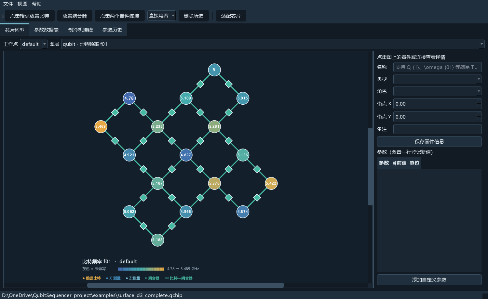

# Qubit Sequencer 芯片登记

用于登记超导量子芯片的逻辑构型、比特/耦合器参数、耦合关系和制冷机接线的本机桌面程序。芯片项目保存为单个 `.qchip` 文件。当前版本为 **0.3.3**。



## 功能

- 顶部项目栏提供新建、打开、备份、全局工作点、导出与主题切换；左侧导航在芯片构型、参数数据表、制冷机接线和参数历史之间切换。
- 芯片构型页提供“查看设计图”按钮，点击后显示设计图，使用“返回构型图”按钮回到逻辑结构图。设计图可在新建时或后续从文件、剪贴板图片导入，支持任意角度旋转、缩放和平移。在图上标注比特、耦合器、读取线及可调 filter 名称，支持按元件类别筛选，拖动调整位置，点击查看参数；图片、角度及标注随项目保存，器件改名同步更新。
- “查看能级图”位于“查看设计图”右侧，在构型页内默认分列绘制标定 f10 的水平线段，可选显示由非谐计算的 f21 虚线，另提供横向频谱布局。支持调节比特间距、开关数值标签和适配完整图幅。图例区分全部比特的标定状态，支持 PNG/SVG 导出。
- 可扩展正方格子、旋转表面码阵列和自定义构型，支持滚轮缩放、拖动平移及适配芯片。构型工具条可手动添加读取线和可调 filter，两个元件均为可选项，模板不会自动添加。读取线依次选择起点和终点，两端吸附格点／半格，支持横向、纵向及斜向直线，Esc 取消。读取线可连接多个比特，filter 可吸附在线上；比特使用到读取线的最短连接，显示读取线时淡化耦合器及其连接。构型页按钮或“视图”菜单可隐藏读取线和 filter。
- 可调/固定 Transmon、直接电容耦合、固定/可调耦合器，以及独立的比特-耦合器物理连接。
- 详情面板和器件弹窗共用编辑草稿；保存更改写入文件，取消更改恢复已保存值，关闭弹窗保留草稿。离开文件时可保存全部、放弃或取消。
- 全部项目编辑支持 Ctrl+Z 撤回、Ctrl+Y / Ctrl+Shift+Z 恢复，也可使用“编辑”菜单。包括器件及连接增删、参数与附件、接线、设计图和共享草稿；对话框中的输入也支持撤回与恢复。当前会话保留最近 100 步，切换项目后清空。
- 带单位的参数、自定义字段、工作点、历史记录及制冷机接线登记。读取线默认登记“读取腔频” [GHz]，filter 默认仅登记“Z 偏置”，不预设偏置为物理电压。参数和线路操作确认后立即写入文件。
- 当前源码的制冷机接线支持盘位与样品映射、各温级元件、放大链、不同温度工作参数和检线记录；按盘号、用途及关键词筛选，详情与导出保留单位。
- 标签与参数表支持简单 TeX 上下标；数据表可横向或纵向显示，表头和单元格提示保留完整名称、单位及原值。
- 文件菜单支持最近项目，Ctrl+R 打开可搜索列表；最多保留 20 项，跨启动保留。
- 频率显示名采用 `f_{10}`，图层中比特参数优先、耦合器参数置后；新记录使用北京时间，旧 UTC 历史按同一时刻换算显示和导出。
- 参数登记可附加图片、代码、文本等文件，支持拖入与粘贴图像。附件内嵌至芯片文件，历史页提供预览、编辑、替换、可恢复移除及版本恢复。
- 导出 XLSX、多份 CSV、PNG/SVG 构型图和参数图；明暗主题采用统一矢量图标和清晰的选中、焦点及禁用状态。

## Windows 发布版

从 [GitHub Releases](https://github.com/Wonder0225/QubitSequencer/releases/latest) 下载发布压缩包并完整解压，双击 `QubitSequencer.exe`。请保留 `_internal` 文件夹和 EXE 的相对位置。

当前仓库为私有仓库，源码和发布文件需使用有访问权限的 GitHub 账号查看。打开随包附带的 `examples/surface_d3_complete.qchip` 可查看完整 d=3 模拟项目。实际芯片文件请保存到发布目录以外。

## 启动

要求 Python 3.11 或更新版本。项目目录下运行：

```powershell
python -m pip install -e .
python -m qubit_sequencer
```

直接打开已有文件，或生成并校验芯片：

```powershell
python -m qubit_sequencer gui examples/surface_d3_complete.qchip
python -m qubit_sequencer sample my_chip.qchip --template surface --mode coupler
python -m qubit_sequencer validate my_chip.qchip
```

当前源码及最新本地编译包使用 v7 文件格式，支持结构化制冷机接线、读取线端点和可调 filter 元件；GitHub 已发布的 Windows 0.3.2 使用 v4。旧 v1–v6 文件打开时先自动备份再迁移，也可执行 `python -m qubit_sequencer migrate my_chip.qchip`。升级后的项目需使用最新本地编译包或源码；切回旧发布版时使用迁移前 `.pre-vN.qchip` 备份。PDF 使用说明由同一份 Markdown 内容生成。

## 文档与示例

- [中文使用说明](docs/user-guide.md) · [PDF 使用说明](output/pdf/user-guide.pdf)
- [版本记录](CHANGELOG.md) · [0.3.2 历史版本说明](docs/releases/v0.3.2.md)
- [科研工作台设计参考](docs/workbench-design-references.md)
- [制冷机接线登记](docs/cryostat-wiring.md) · [`.qchip` 格式规范 v7](docs/qchip-format-v7.md) · [v6 格式规范](docs/qchip-format-v6.md)
- [构型图设计参考](docs/diagram-design-references.md)
- [比特能级图调研与实现说明](docs/energy-level-diagrams.md)
- [`.qchip` 格式规范 v4](docs/qchip-format-v4.md) · [v3 格式规范](docs/qchip-format-v3.md) · [旧 v2 格式规范](docs/qchip-format-v2.md)
- [完整 d=3 模拟演示项目](examples/surface_d3_complete.qchip)
- [芯片设计图测试示例](examples/chip_design_release_demo.qchip) · [测试操作说明](examples/chip_design_demo.md)
- [构型图](examples/surface_d3_complete_topology.png) · [比特频率图](examples/surface_d3_complete_qubit_f01.png)
- [明色界面](examples/surface_d3_complete_preview.png) · [纵向数据表](examples/surface_d3_complete_table_vertical.png) · [深色界面](examples/surface_d3_complete_dark_preview.png)
- [GitHub 发布说明](docs/github-publishing.md) · [第三方组件说明](THIRD_PARTY_NOTICES.md)

演示项目内所有参数、工作点和接线都是模拟值。顶部主题按钮和“视图 > 深色模式”均可切换配色；图片导出沿用当前主题。

## 构建 Windows 发布版

```powershell
python -m pip install -e ".[build]"
powershell -File scripts/build_windows_release.ps1
```

最新编译版的固定启动入口为 `output/release/QubitSequencer/QubitSequencer.exe`，快捷方式为 `output/release/Qubit Sequencer.lnk`；可将该快捷方式固定到开始菜单，后续编译默认更新同一路径。最终压缩包使用 `QubitSequencer-<版本>-win64.zip` 命名，`output/release/LATEST.txt` 记录构建版本、时间和固定文件路径。更新前将旧固定目录完整保留在 `output/release/previous/`，历史构建及压缩包保留；实际项目仍建议另存到发布目录之外。仅需隔离构建时使用 `-SkipLocalPublish`，不会更新固定入口。

“帮助 > 版本信息”显示软件版本、当前 `.qchip` 格式以及支持打开的格式版本。当前支持 v1–v7，旧格式先备份再升级到 v7。设计图查看支持“半透明标注”按钮，以 50% 不透明度显示标注，便于查看下方版图。

仓库附带中文 PDF。修改文档后可安装 `.[docs]` 并运行 `python scripts/build_user_guide_pdf.py`；此脚本需要 Windows 中文字体。运行 `python scripts/capture_demo.py` 可更新真实界面截图；脚本使用示例文件副本和隔离设置，不修改源示例或个人窗口设置。

软件按单人编辑设计。需要传阅时使用“另存备份”，避免多人同时写同一个 `.qchip`。标定实验记录与附件已有存储接口，完整管理界面将按实际实验需求继续扩展。本地 `projects/`、构建缓存与发布目录不会提交到 Git。

## 许可

源码采用 [MIT 许可](LICENSE)。Windows 发布包中的第三方组件保留各自许可，见 [第三方组件说明](THIRD_PARTY_NOTICES.md) 和 `licenses/third-party/`。
