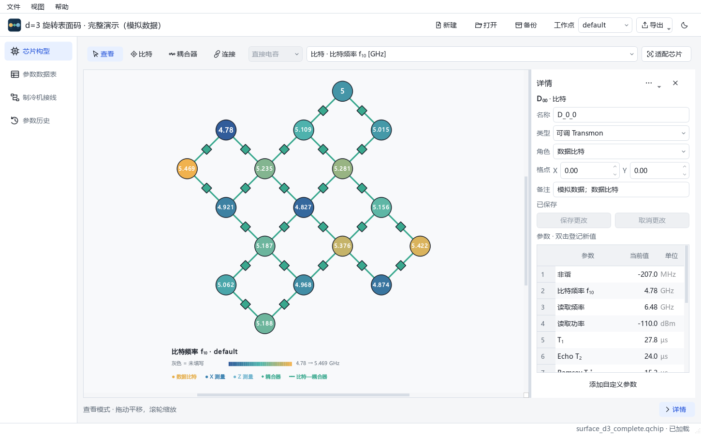
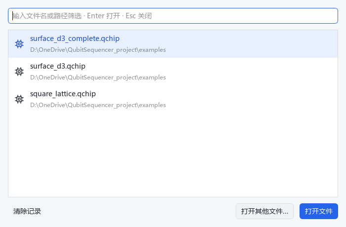
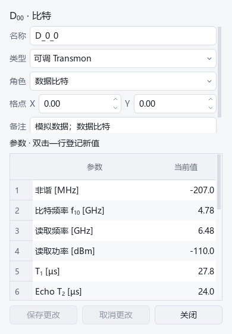
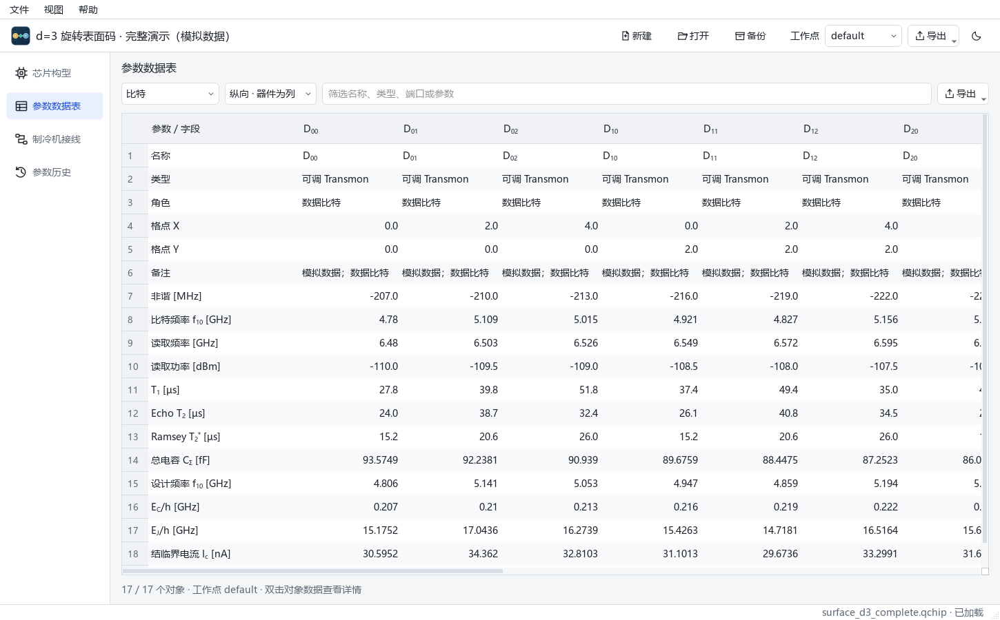
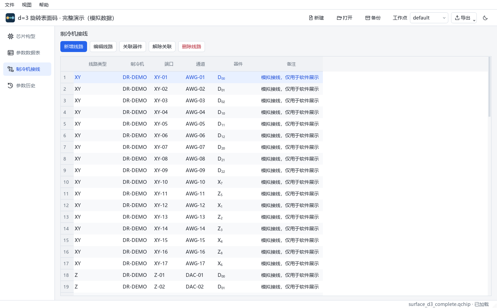
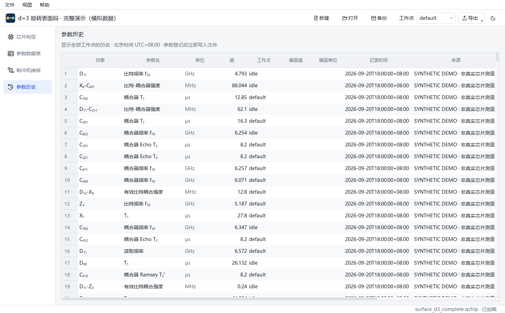

# Qubit Sequencer 使用说明

版本 0.3.1 · Python 与 Windows 桌面版

本文适用于包含参数附件管理的 0.3.1 源码及 Windows 发布版。随包 PDF 保留此前版本；新增附件操作以本文为准。

## 1. 认识科研工作台

Qubit Sequencer 用一个 `.qchip` 文件保存一块超导量子芯片的逻辑构型、比特/耦合器、连接、物理参数、制冷机接线及参数标定附件。当前源码使用 SQLite v3 格式，旧项目先备份再升级。`examples/surface_d3_complete.qchip` 是已补齐参数与接线的 d=3 旋转表面码模拟演示项目。



顶部项目栏显示芯片名称和未保存草稿数量，并提供新建、打开、备份、工作点、导出与主题切换。工作点属于当前项目的全局视图：在任何页面切换都影响参数当前值、构型图层、参数数据表和导出；参数历史仍显示全部工作点的记录。

左侧四项导航依次为“芯片构型”“参数数据表”“制冷机接线”“参数历史”。选中项有明确底色。构型页的工具条仅处理查看、放置、连接、图层与适配；右侧详情可以收起，也可以用底部“详情”按钮重新展开。

顶部主题按钮或“视图 > 深色模式”会同时切换菜单、画布、数据表及器件弹窗。窗口位置、详情宽度和明暗选择会在下次启动时保留。

<!-- pagebreak -->

## 2. 安装与打开项目

Windows 发布包完整解压后，双击 `QubitSequencer.exe`。请保持 EXE 与 `_internal` 文件夹的相对位置。程序的“帮助 > 使用说明 PDF”可打开本说明。

从源码运行需要 Python 3.11 或更新版本。在项目目录执行：

```powershell
python -m pip install -e .
python -m qubit_sequencer
```

也可直接打开文件或生成示例：

```powershell
python -m qubit_sequencer gui examples/surface_d3_complete.qchip
python -m qubit_sequencer sample demo.qchip --template surface --mode coupler
python -m qubit_sequencer validate demo.qchip
```

顶部“打开”或“文件 > 打开 .qchip”选择已有项目；“新建”要求选择文件位置、填写芯片名称并选择模板。实际项目应放在有写入权限且位于发布目录以外的位置。“备份”复制当前已写入的文件为另一个可独立打开的 `.qchip`；请先保存要包含在备份中的器件草稿。

“文件 > 打开最近的文件”按最近访问顺序列出项目，悬停可查看完整路径。“显示全部最近文件…”或 Ctrl+R 打开搜索列表；输入文件名或路径，Enter 打开，Esc 关闭。列表跨启动保留，最多 20 项；失效文件会标明。清除记录只清空列表。



`validate` 显示 `OK` 表示数据库完整性、外键、连接对象和参数附件校验通过。旧 v1/v2 文件打开时会先自动生成迁移备份再升级到 v3；软件不会覆盖已有同名备份。v3 文件可用当前源码或包含附件管理的 Windows 0.3.1 发布版打开，旧版程序不支持 v3。

<!-- pagebreak -->

## 3. 构型、选择与器件编辑

新建时可选“自定义格点”“正方格子”或“旋转表面码”。自定义格点的初始行列只是视野参考；正方格子自动建立最近邻关系；旋转表面码按奇数码距生成数据比特和 X/Z 测量比特，保留模板名称，d=3 有 17 个比特，d=5 有 49 个比特。模板连接可选直接电容、经耦合器或暂不连接。

“查看”模式下滚轮缩放，拖动空白处平移，“适配芯片”恢复全貌。自定义格点和正方格子可在初始范围外放置器件；比特使用整数格点，耦合器允许半格，负坐标也可使用。旋转表面码模板的格点由生成器管理，需要自由放置时请从自定义格点开始。

“比特”和“耦合器”按钮进入放置模式。“连接”模式下依次点击两个器件：两个比特可按所选模式建立直接耦合或在中点生成耦合器；一个比特与已有耦合器可建立独立物理连接。每个耦合器最多连接两个比特，也可保留单端连接或暂未连接的耦合器。

点击器件或连接会更新右侧详情。普通查看模式点击器件还会弹出鼠标旁的编辑窗；连接模式的器件点击用于选择端点。详情与弹窗共用名称、类型、角色、X/Y 坐标、备注以及同一份草稿。



名称支持简单 TeX，例如 `Q_{1,2}`、`C_{01}`、`\omega_{01}`、`\Phi_0`、`Q^*`。原始输入保存在文件，画布、导出和详情标题显示排版后的标签。自定义角色如 `readout`、`spectator` 或 `Aux_{1}` 会使用稳定分类颜色。此功能只处理常用上下标与符号。

删除通过详情“更多”菜单执行，并要求确认。Delete 快捷键仅在芯片画布具有焦点时删除当前所选对象；在名称、备注、筛选框等输入控件中，Delete 仍是文本编辑键。

<!-- pagebreak -->

## 4. 草稿、保存、取消与关闭

修改器件名称、类型、角色、坐标或备注时，先形成该对象的草稿。详情与弹窗即时显示同一份内容；切换到其他对象、其他页面或主题，草稿仍保留。顶部显示未保存对象数量，编辑器显示当前对象的未保存状态。

- **保存更改**：校验并把当前对象草稿写入 `.qchip`。名称不能为空，坐标必须为有限数值；错误会保留输入并显示原因。保存成功后，画布、表格、详情和另一编辑窗口同步更新。
- **取消更改**：放弃当前对象的草稿，恢复文件中最近一次保存的内容。它只影响当前对象，不影响其他对象的草稿。
- **关闭弹窗或点击窗外**：关闭这个窗口，保留草稿。再次查看该器件时可以继续编辑；关闭不等于保存，也不等于取消。
- **切换对象**：各对象分别保留草稿。返回先前对象后仍能看到未保存的输入。
- **参数登记和接线操作**：对话框确认后立即写入文件。这些已确认记录不属于器件基本信息草稿；“取消更改”不会撤销它们。

新建项目、打开其他文件或关闭主窗口时，若存在草稿，会出现离开提示：

- **保存全部**：逐个校验并保存所有对象，然后离开。若有对象保存失败，当前文件继续打开，可修正错误后再试。
- **放弃更改**：放弃当前文件所有未保存草稿后离开；已确认写入的参数和接线保留。
- **取消**：继续留在当前文件，所有草稿保留。

右侧详情支持拖动分隔条调整宽度；收起详情仅改变视野，不清除草稿。删除对象会清除对应草稿。请定期备份已保存的项目。

<!-- pagebreak -->

## 5. 全局工作点与参数数据表

顶部工作点可选择或输入 `default`、`idle`、`readout`、`max` 等名称。它决定当前查看及登记参数的工作点，也决定 XLSX、CSV 和图片导出的当前值。切换工作点会刷新已打开的详情与器件弹窗，器件基本信息草稿保持不变。

选择器件或连接后，双击详情或弹窗的参数行，填写新值、可选偏置、偏置单位、来源和备注。确认登记会生成一条历史记录并立即写入文件；写入失败时保留对话框输入，可修正后重试。留空表示当前值未填写；数值 `0` 按真实零保存。

预置项涵盖频率、非谐、读取频率/功率、T1、Ramsey T2*、Echo T2、耦合与常用设计参数。比特-耦合器每段物理连接有独立 `link.g_qc`；两比特有效耦合使用 `coupling.g_effective`。“添加自定义参数”可登记键、名称、数值/文本类型和单位。



“参数数据表”可切换比特、耦合器、比特-耦合器连接、耦合和接线。横向模式以器件为行，纵向模式以器件为列。筛选可匹配名称、类型、端口或参数；纵向输入参数名时筛选对应字段，输入器件内容时筛选对象列。底部显示可见对象数量和当前工作点。

ID 在界面隐藏，导出时保留。双击器件、连接或耦合的数据可回到构型页查看详情。表头显示简洁名称，悬停查看完整字段及单位；单元格悬停可看原值或“未填写”。类型和角色以中文名称显示，名称支持简单 TeX，数值靠右，单位采用次要文字色。

频率显示名采用 `f_{10}`，内部参数键沿用 `qubit.f01` 和 `coupler.f01`，旧项目的参数关联保持有效。自定义参数名称支持 `f_{10}`、`T_{2}^{*}`、`\omega_q` 等简单 TeX，输入时提供预览；图层选择、详情、登记标题、历史、数据表与图片使用相同排版。图层参数按比特、两比特耦合、物理连接、耦合器顺序排列。

<!-- pagebreak -->

## 6. 制冷机接线

左侧选择“制冷机接线”，点击“新增线路”，填写 XY、Z、读出或自定义线路类型，以及制冷机、端口、通道和备注。此前在画布选中的器件可自动关联到新线路；一条线路允许关联多个器件。



必须先选择表格中的线路行，才可使用“编辑线路”“关联器件”“删除线路”。“解除关联”还要求当前行包含已关联器件；未选行或缺少关联时，按钮显示禁用态。点击“关联器件”后从器件列表选择对象；解除关联只移除所选行的器件关系，线路本身保留。删除线路会删除线路及其器件关联，并要求确认。

接线编辑确认后立即写入项目文件。表中使用行选中，当前选择随刷新保留。悬停查看完整端口、备注或器件原名；端口参数图可按线路信息展示。

<!-- pagebreak -->

## 7. 参数历史与表格导出



“参数历史”显示全部工作点的记录，包括对象、参数、时间、工作点、偏置、来源和当前值标记。重复登记参数会保留旧记录，便于追踪标定结果。

### 标定附件

登记参数时，可在“附件（可选）”区域点击“添加文件”多选谱图、脚本、文本等，也可拖入文件。点击“粘贴图像”或按 Ctrl+V 可直接导入剪贴板中的截图，保存为 PNG；普通文本仍粘贴到当前输入框。附件保存字节快照，原文件之后移动或删除不会影响已登记结果。超过 50 MiB 的文件会询问是否继续。附件工具栏采用紧凑按钮，鼠标悬停可查看完整操作说明。

选择附件可查看图片或代码/文本，编辑文件名和说明。图片支持适配、100%、滚轮缩放和拖动；文本支持 UTF-8、UTF-8 BOM、GB18030，并保留编码。无法解码的内容可保存副本或替换，不强行转码。登记确认后，参数和全部附件一起写入；读取或写入失败时保留输入。存在导入失败项时，须重试或明确点击“移除失败的导入项”后才能保存。

历史页新增“附件数量”。选中记录后点击“管理附件”，或双击历史行，打开记录详情：左侧为附件列表，右侧为预览及编辑。旧记录也能添加附件；排序和刷新不会改变附件归属。

修改、替换、改名和说明先暂存，“保存更改”统一写入并生成版本；“取消更改”恢复已保存状态。关闭有未保存更改的窗口时，可保存、放弃或取消；保存失败时继续保留输入。

版本下拉框可查看旧内容并保存副本，旧版本只读。“恢复版本”先暂存，保存后追加新版本；此前版本全部保留。“移除”隐藏附件且保留内容，勾选“显示已移除”后选择附件并点击“恢复”可恢复。附件操作不修改参数数值、工作点或原测量时间。

“导出”将当前预览内容保存为副本。PDF、PPTX 等文档可点击“外部打开”，由系统默认程序打开临时副本；外部修改须用“替换”重新导入。代码只作为文本编辑。数据库备份包含附件及全部版本，XLSX/CSV 不嵌入附件。

从 0.3.1 起，新记录使用北京时间 UTC+08:00。旧记录的时区信息保留，显示和导出按同一时刻换算为北京时间，日期也会相应变化；记录按实际时间排序。通过读写接口传入无时区时间时按北京时间解释，带时区时间则换算后保存。

顶部“导出”或“文件”菜单提供 XLSX 和 CSV。XLSX 包含芯片信息、比特、耦合器、物理连接、有效耦合和接线工作表；CSV 输出同结构的多份文件。两种格式可选择附加参数历史，当前值部分使用顶部工作点。CSV 使用 UTF-8 BOM，方便 Windows Excel 打开。

<!-- pagebreak -->

## 8. 图层、图片与常见问题

构型工具条的图层下拉框可切换原始构型、参数、器件类型、角色、接线和耦合方式。参数图隐藏器件标号，短值居中，多组端口分行，长文本使用细引线关联。连接标签避让器件和其他文字；点击标签可查看所属连接。下方注释显示字段、工作点、颜色范围及单位，灰色表示未填写。

“导出当前图片”保存 PNG 或 SVG，并选择输出宽度；“批量导出参数图”输出原始构型及全部参数/分类图。图片使用当前工作点和明暗主题。PNG 可直接用于报告，SVG 适合矢量排版。自定义角色图例按实际角色生成，多个图例项自动换行；适配后窗口尺寸变化仍保持完整显示。

- **文件在哪里？** 新建时选择的位置就是项目位置。器件基本信息需要保存更改，参数和接线确认后立即写入。备份只包含已写入内容。
- **为何有迁移备份？** 打开 v1/v2 项目会生成升级前备份。确认 v3 文件正常后再自行归档；切回旧发布版时请使用升级前备份。
- **为什么只看到 5×5？** 这是初始视野。拖动空白可继续平移；自定义格点与正方格子可在范围外放置。
- **为何图上有灰色节点？** 所选工作点没有当前参数值。检查顶部工作点并登记参数。
- **为何点连线看到物理连接？** 经耦合器的每段线独立记录 `link.g_qc`；两比特有效耦合可从“参数数据表 > 耦合”查看。
- **保存按钮为何不可用？** 未选择对象，或当前草稿与已保存内容相同。接线操作则需要明确选择线路行。
- **表中空值和 0 有区别吗？** 空值表示未填写；0 是有效数值。悬停可查看完整值和单位。
- **能否同时编辑同一文件？** 当前按单人编辑设计。传阅时复制文件，避免多人同时写同一项目。
- **标定扫参附件在哪里？** 在参数登记窗口添加，之后从“参数历史 > 管理附件”访问。原有独立标定接口保存的附件会保留，但不会自动推断其参数历史归属。

更多资料见仓库 README、格式规范 v3 和版本记录。演示数据用于查看界面及流程，不代表实际实验结果。
